<picture>
  <source media="(prefers-color-scheme: dark)" srcset="assets/banner-dark.svg">
  <source media="(prefers-color-scheme: light)" srcset="assets/banner-light.svg">
  
</picture>

I'm a co-founder of [Sharq](https://www.sarq.ai), a Dubai company building private, Arabic-first AI for banks, government and regulated firms in the Gulf. Everything we make runs inside the customer's own infrastructure, learns from their own records, and stays theirs.

## Building at Sharq

- **[S1](https://www.sarq.ai/s1)**  
  The model that does the thinking.
- **[AE-1](https://www.sarq.ai/products/ae-1)**  
  A private assistant for your people.
- **[Engine](https://www.sarq.ai/products/engine)**  
  Trains and serves models on your data, where the data lives.

## Say hello

[sarq.ai/about](https://www.sarq.ai/about)

The lines along the bottom of the picture are my last year of public activity here, one a day. A script in this repo redraws them every morning.
